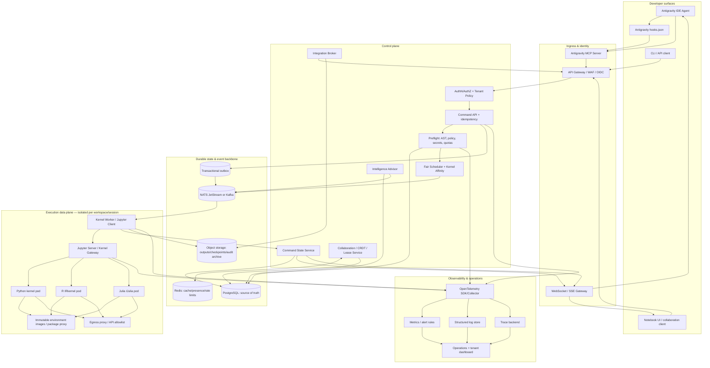
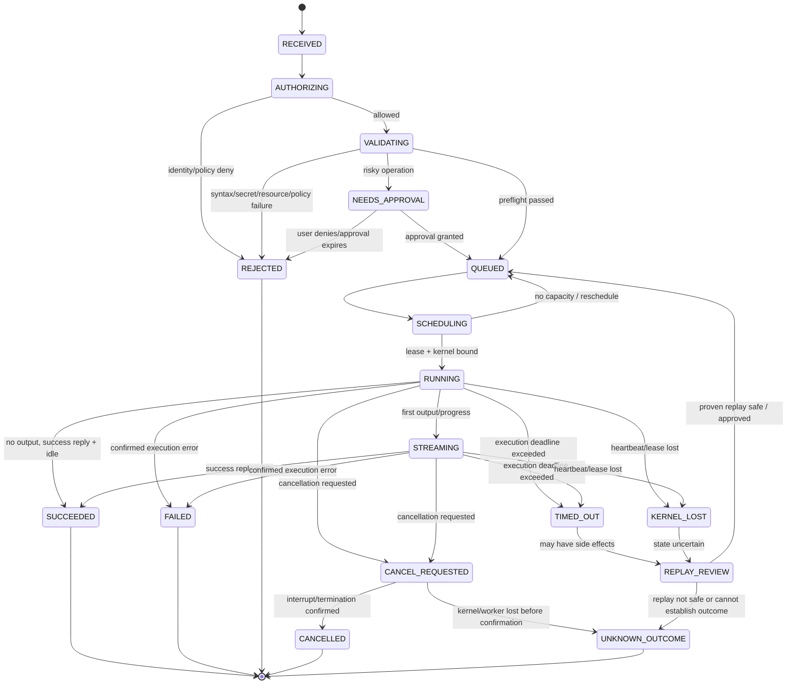
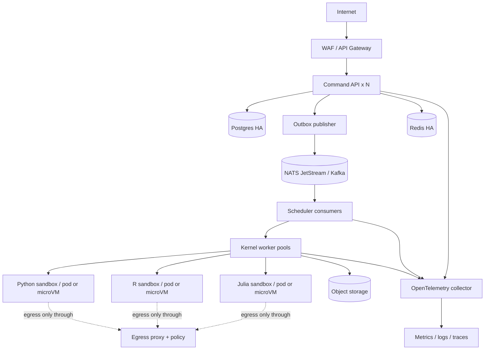

# Antigravity IDE Multi-Agent System
## Enterprise System Architecture Document (SAD)

**Verzija:** 1.0  
**Datum:** 14. oktobar 2026.  
**Status:** Predloženi referentni dizajn — spreman za tehnički review, nije tvrdnja o postojećoj implementaciji  
**Primarna platforma:** Google Antigravity IDE / Antigravity CLI integracija, Jupyter Server i Jupyter kernels  
**Ciljevi:** 1.000+ istovremeno otvorenih komandi, p95 enqueue < 100 ms, dostupnost control plane-a 99,9%, izolacija tenant-a, streaming output, audit trail

---

## 0. Executive summary i ključne projektne odluke

Predlaže se **event-driven control plane + izolovani execution data plane**. Antigravity je IDE/agent integraciona površina; nije jedini enforcement point. Komande koje potiču od Antigravity agenata prolaze kroz `Antigravity Adapter` (native hooks + MCP tools), a komande koje dolaze iz notebook UI-ja kroz `Notebook Gateway`. Obe putanje završavaju u istom `Command API`, validaciji, trajnoj evidenciji i scheduler-u. Scheduler šalje posao worker-u koji poseduje ili može da pristupi konkretnom Jupyter kernel-u. Svaki kernel ima serijski izvršni red, jer Python/R/Julia sesija sadrži promenljivo stanje.

### Nezaobilazne odluke

1. **Hook nije bezbednosna granica.** Antigravity hook-ovi se koriste za preflight, audit i blokiranje podržanih tool poziva; backend gateway i sandbox moraju da budu obavezni enforcement point. Dokumentacija Antigravity navodi `SessionStart`, `PreToolUse`, `PostToolUse`, `PreInvocation`, `PostInvocation` i `Stop`; hook prima/vrati JSON preko stdin/stdout i `PreToolUse` podržava odluke `allow`, `ask`, `force_ask`, `deny` i `deny_unless_prior_grant`. Ta mogućnost je korisna, ali ne treba pretpostaviti da hook presreće svaki mogući kernel ili terminal put bez integracionog testa. [Antigravity Hooks](https://www.antigravity.google/docs/hooks)
2. **Jupyter kernel nije stateless worker.** Jedan kernel po pravilu izvršava komande redom i čuva stanje između ćelija. Load balancing se radi pri kreiranju/forkovanju kernel sesije; ne migrira se proizvoljno aktivan Python proces sa promenljivama na drugi host.
3. **1.000 concurrent commands znači prvo 1.000+ prihvaćenih/queued komandi.** Broj komandi koje stvarno rade istovremeno ograničava kapacitet CPU/RAM/GPU i serijalizacija po kernel-u. Ako zahtev znači 1.000 aktivnih kernel execution-a, to mora da bude poseban kapacitetni cilj sa znatno većim infrastrukturnim budžetom.
4. **Exactly-once izvršavanje proizvoljnog koda se ne obećava.** Broker može dostavljati najmanje jednom; sistem garantuje idempotentno prihvatanje i deduplikaciju komande. Ako radnik nestane nakon što je kod počeo da pravi spoljne efekte, automatsko ponovno izvršavanje može duplirati efekte. Takva komanda ulazi u `UNKNOWN_OUTCOME` ili `KERNEL_LOST` i zahteva replay-safety odluku.
5. **AST analiza nije sandbox.** AST/linter/secret scan otkrivaju poznate rizike; Python introspekcija, native biblioteke, shell magics, `ctypes`, subprocess-i i mrežne operacije zahtevaju OS/VM izolaciju i mrežne politike.
6. **Tenant isolation je po trust boundary-ju, ne samo po Python namespace-u.** Minimalno izolovati kernel u posebnom pod-u sa pod-level limitima; za nepouzdan multi-tenant kod koristiti gVisor/Kata/Firecracker klasu izolacije i privatnu mrežu. gVisor eksplicitno opisuje dodatni sandbox sloj za višeterantska i nepouzdana workload okruženja, uz mogući performance overhead. [gVisor production guide](https://gvisor.dev/docs/user_guide/production/)
7. **Audit log je append-only i nezavisan od LLM-a.** Agent ne može odlučivati da li se audit događaj upisuje, brisati događaje ili sam sebi dodeliti privilegije.

### Pretpostavke i granice

- Antigravity IDE se tretira kao editor/agent okruženje sa hooks, MCP, agent tools i workspace konfiguracijom. Zvanična dokumentacija navodi agentove alate za editor, terminal i browser, paralelne agente i artifacts. Za enterprise konfiguracije dokumentacija trenutno upućuje na Antigravity 2.0 ili CLI, pa deployment mora da potvrdi izabranu Antigravity ediciju i enterprise support pre produkcije. [Antigravity IDE overview](https://www.antigravity.google/docs/ide/overview/)
- Ne pretpostavlja se da postoji javni low-level Antigravity kernel API. Kernel kontrola ide preko Jupyter protokola/Jupyter Server-a i custom MCP servera, a Antigravity hooks se koriste samo za dokumentovane tool događaje.
- SLO vrednosti su projektni ciljevi koji se moraju potvrditi testovima u ciljnom cloud-u, ne garancije date od vendora.

---

# 1. Sistem na jednom mestu

## 1.1 Logička arhitektura



## 1.2 Trust boundaries

- **TB-1 Browser/IDE → public API:** authenticated identity, payload limits, CSRF/CORS policy where relevant, WAF, request rate limiting.
- **TB-2 Control plane → kernel execution plane:** commands are immutable snapshots with a tenant, workspace, kernel and authorization context. No database credentials or broad cloud tokens are passed to kernel processes.
- **TB-3 Kernel → external network:** deny by default; only egress proxy can reach approved hosts/services. Block cloud metadata ranges, internal control-plane addresses and private network ranges unless a tenant-scoped policy explicitly allows them.
- **TB-4 Tenant → tenant:** separate filesystem, process namespace, kernel, credentials, cache namespace, object prefixes and encryption context. Never put tenant-sourced Python execution in a shared long-lived kernel.
- **TB-5 Untrusted output → browser/LLM:** HTML, JavaScript, SVG, exception strings, notebook output and repository content are untrusted. Sanitize display and delimit data as untrusted context before LLM analysis.
- **TB-6 Integration broker → vendors:** short-lived or scoped credentials, provider-specific permission boundary, explicit audit and egress rules.

## 1.3 Architectural style

Start with a **modular control-plane service** instead of 15 independent microservices. Keep clear domain boundaries (`commands`, `scheduler`, `collaboration`, `integration`, `policy`, `intelligence`) but deploy separately only where scale/security requires it. The kernel execution plane is independently scalable and tenant-isolated. Recommended initial backing services: PostgreSQL HA, NATS JetStream (or Kafka if already an organizational standard), Redis for ephemeral presence/cache/rate limits, S3/GCS-compatible object storage, OpenTelemetry collector, Prometheus-compatible metrics, and a trace/log backend.

---

# 2. Layer 1 — Command interception

## 2.1 Antigravity integration pattern

### A. Native hooks adapter

Configure workspace hooks in `.agents/hooks.json`, with user/global configuration at `~/.gemini/config/hooks.json` only where operationally appropriate. Use:

- `SessionStart`: bind `conversationId`, workspace list and session policy; issue a short-lived session correlation ID.
- `PreInvocation`: inject concise operational guidance, not secrets or large execution history.
- `PreToolUse` with matcher for documented execution tools such as `run_command`; call a **fast local policy client** that returns `allow`, `ask`, `force_ask`, `deny` or `deny_unless_prior_grant`.
- `PostToolUse`: capture exit status/error, command correlation, duration and redacted result summary.
- `PostInvocation`: attach model-call metadata if available and collect decision traces.
- `Stop`: flush outstanding event buffers and mark the agent-side session as ended; do not imply that a kernel has stopped until the kernel control plane confirms it.

Hook scripts must be short (target p95 < 20 ms for local-only rules), time-bounded, deterministic where possible and must not block on LLM calls. Antigravity documents a default hook timeout of 30 seconds, which is far too long to use as a normal latency budget for every command. The production configuration should set explicit, low timeouts for synchronous preflight. [Hook schema and handler contract](https://www.antigravity.google/docs/hooks)

### B. MCP command surface

Provide a dedicated `antigravity-kernel-control` MCP server as the only sanctioned path for notebook execution and environment actions:

| Tool | Purpose | Risk class |
|---|---|---|
| `command.submit` | Submit a notebook cell or explicit shell/package action | Medium/high; policy gated |
| `command.status` | Return current state and timing | Low |
| `command.output` | Retrieve bounded output pages or artifact references | Low; tenant scoped |
| `command.cancel` | Request interrupt; only terminate kernel when necessary | Medium |
| `kernel.list` | List authorized kernel sessions | Low |
| `kernel.create` | Create a kernel using an approved image/kernelspec | Medium |
| `kernel.restart` | Restart a kernel; requires explicit approval if state loss is possible | High |
| `environment.resolve` | Resolve dependency set without mutating running kernel | Medium |
| `environment.install` | Build a new immutable environment revision; no uncontrolled mutation of shared env | High |
| `checkpoint.create` / `checkpoint.restore` | Create/restore notebook + environment + metadata checkpoint | Medium/high |
| `integration.github.*` | Scoped GitHub operations through integration broker | Depends on operation |
| `integration.drive.*` | Scoped Drive operations through integration broker | Depends on operation |

Agent tools should return structured metadata plus an opaque `command_id`; long-running output is streamed separately. An LLM-generated shell string is never a trusted authorization object.

### C. Coverage model

The system can claim complete tracking **only if every code-execution route is routed through the gateway or is reliably intercepted by a mandatory policy boundary**. Hooks are documented for specific Antigravity tools and events, not a universal kernel-level syscall monitor. Direct external Jupyter connections, custom subprocesses or unsupported IDE tools could otherwise bypass tracking. Production acceptance must include a route-coverage test matrix for terminal, `run_command`, MCP, notebook cell execution, magics, package install, restart/interrupt, browser-triggered actions and external API calls.

## 2.2 Canonical command envelope

Each submitted command becomes a versioned record:

```json
{
  "schema_version": "1.0",
  "command_id": "uuid",
  "idempotency_key": "client-provided-opaque-key",
  "tenant_id": "tenant_uuid",
  "workspace_id": "workspace_uuid",
  "session_id": "session_uuid",
  "kernel_id": "kernel_uuid",
  "actor": {"type": "user|agent|automation", "id": "principal_uuid"},
  "source": {"surface": "antigravity|notebook_ui|api|webhook", "conversation_id": "optional"},
  "language": "python|ipython|r|julia|bash|package",
  "mode": "cell|shell|magic|environment|control",
  "source_hash": "sha256:...",
  "source_ref": "encrypted-blob-reference-or-restricted-notebook-cell-reference",
  "document_revision": 42,
  "kernel_epoch": 3,
  "priority": "interactive|normal|background",
  "timeout_ms": 30000,
  "resource_profile": "standard-cpu",
  "depends_on": [],
  "policy_version": "policy-2026-10-01",
  "created_at": "RFC3339 UTC"
}
```

Never log raw source or outputs by default. Store a redacted source snapshot in encrypted object storage only if required by retention policy; record hash, byte length, language, policy decisions and output artifact references in the ordinary audit row. Secrets need pre-storage redaction as well as UI redaction.

## 2.3 Queue management and admission control

- Use durable queues partitioned by `(tenant_id, workspace_id, kernel_id)` with an ordering key per kernel.
- Interactive work has a higher class than background optimization, but strict priority can starve batch work. Use **weighted fair queueing / deficit round robin plus aging**.
- Apply per-tenant token bucket admission limits, per-workspace outstanding-command limits, and global queue-depth backpressure.
- Accept a command only after transactionally writing `commands` and an outbox event. `202 Accepted` returns only after the durable state transition.
- `Idempotency-Key` plus unique `(tenant_id, idempotency_key)` prevents duplicate request creation; a duplicate returns the original `command_id`.
- Reject oversize payloads before AST parsing. Initial design target: 1 MiB source code and 8 MiB inline output limit, with large outputs streamed to object storage.
- The 100 ms target is **API admission latency**, not full code execution latency.

## 2.4 AST, parsing and pre-flight validation

### Parser routing

1. Detect language from kernel spec, cell metadata and explicit mode. Do not trust MIME/language supplied only by user if it conflicts with bound kernel identity.
2. Python source: `ast.parse` plus a version-aware parser environment. Run static rules on imports, file writes, subprocess, sockets, dynamic evaluation, `ctypes`, credential patterns and known dangerous builtins.
3. IPython: recognize `%magic`, `%%cell_magic`, `!shell`, `!!`, `%pip`, `%conda`, `%%bash`, `%%script` before normal Python parsing. A Python AST parser is not a valid parser for every IPython cell. Route shell magics to a shell policy and environment magics to an environment policy; never attempt to validate `!` commands as if they were Python.
4. R and Julia: use language-specific parser/tree-sitter grammar and approved lint rules. The execution adapter remains Jupyter-protocol based, so the scheduler need not understand every language’s runtime.
5. Shell: tokenize/parse using a shell-aware parser; string regex alone is insufficient for nested quoting, command substitution, pipes and redirections.
6. Notebook document: validate `.ipynb` with `nbformat`, cell IDs and revisions; sanitize HTML/JS outputs before browser rendering.

### Validation pipeline

`payload/tenant limits → identity/authorization → idempotency → syntax → static policy → secret scan → dependency scan → resource estimate → approval check → queue eligibility`.

Deterministic checks must complete before any model-based advice. An LLM can explain findings, but cannot override a hard policy denial. AST analysis is risk classification and linting, not proof that a program is safe.

### Dependency resolution

- Resolve `pip`/`uv`, `conda/mamba`, `npm`, R `renv` and Julia `Pkg` requests into immutable environment revisions.
- Use lockfiles and content hashes; detect Python ABI, CUDA, CPU architecture, OS and transitive dependency incompatibilities.
- Run package resolution/build in a separate restricted builder; never install unreviewed packages into the currently running shared kernel environment.
- Cache environment layers by `(base_image_digest, lockfile_hash, platform, accelerator_class)`.
- Warn on dependency drift when notebook metadata, kernel image and lockfile do not align.

---

# 3. Layer 2 — Execution orchestration

## 3.1 Execution worker model

**Kernel affinity is mandatory.** The scheduler routes new work to the currently assigned kernel owner. Commands for one mutable kernel are serialized even when commands for other kernels run in parallel. An optional isolated “fork kernel” can provide speculative parallel execution, but it has a distinct state and cannot silently replace the original kernel.

Each `KernelWorker` owns a Jupyter client connection and performs:

1. Acquire a lease with a monotonically increasing fencing token.
2. Verify the kernel epoch and expected document/cell revision.
3. Set command correlation metadata and subscribe to relevant IOPub output.
4. Send `execute_request` or approved control request.
5. Stream `stream`, `display_data`, `execute_result`, `error`, `clear_output`, progress, and status events.
6. Wait for both the matching `execute_reply` and the appropriate idle state, applying an execution timeout.
7. Persist outputs, final status and resource observations.
8. Release/renew the lease and emit an immutable completion event.

Jupyter’s messaging documentation states that an executing kernel publishes `busy`, emits associated IOPub messages, replies on the shell channel (for example `execute_reply`), and eventually publishes `idle`. Responses are correlated through message headers; the adapter must handle asynchronous/background IOPub messages that do not fit a simple one-message/one-output assumption. [Jupyter messaging protocol](https://jupyter-client.readthedocs.io/en/latest/messaging.html)

## 3.2 Kernel scheduler and load balancing

Scheduling dimensions:

- **Tenant fairness:** weighted fair-share slots and resource quotas.
- **Kernel affinity:** existing stateful session stays on its current owner.
- **Environment affinity:** warm pool keyed by image/lock hash, Python version and accelerator class.
- **Resource fit:** CPU, RAM, GPU, ephemeral disk, current queue depth, kernel health, and placement constraints.
- **Priority:** interactive, standard, background.
- **Locality:** object-storage and package-cache locality, without violating tenant isolation.

Kubernetes HPA can scale deployment replica counts based on observed metrics; KEDA can scale consumers from event/queue metrics. Neither solves per-kernel serialization by itself. Use queue age and eligible free kernel slots as custom autoscaling inputs. [Kubernetes autoscaling](https://kubernetes.io/docs/concepts/workloads/autoscaling/)

## 3.3 Timeouts, memory and process limits

Use three distinct timers:

- `admission_timeout`: target p95 < 100 ms; reject/backpressure if capacity is unavailable.
- `queue_deadline`: maximum allowed waiting time by priority/tenant; for example 30 seconds interactive, 5 minutes background (adjust from user expectations).
- `execution_timeout`: user/policy-selected ceiling, default 30 seconds for normal cells; longer jobs must declare a profile and receive a larger timeout/budget.

Enforce on the container/VM, not just inside Python:

- CPU quota and CPU time budget;
- cgroup memory limit and `memory.oom` observation;
- PID/process count limit;
- ephemeral disk quota;
- output byte / event rate cap;
- wall clock deadline;
- GPU memory and GPU time policy where supported;
- maximum open files and file size where relevant.

For long running jobs, stream progress and offer explicit cancel. “Graceful shutdown” means request interrupt, allow a small grace interval, then terminate the kernel container if it does not respond. The command gets `CANCELLED` only if cancellation is confirmed; if the process outcome cannot be established, use `UNKNOWN_OUTCOME`/`KERNEL_LOST`.

## 3.4 Output streaming and visualization

- Use WebSocket or SSE from the application gateway to the browser; use WebSocket when bi-directional interactive control is required.
- Publish a normalized event envelope: `command_id`, `event_seq`, `kernel_id`, `message_type`, `mime_types`, `chunk_ref`, `timestamp`.
- Preserve `parent_header.msg_id`, message ID, cell ID, and kernel epoch to correlate data. Don’t show kernel stdout by simply merging all IOPub messages by arrival time.
- Inline small text and images; stream large images, dataframes, arrays and files as object-store artifact links.
- Support `image/png`, `text/plain`, `text/html`, Plotly MIME bundles and widget comm events only through a renderer sandbox. Sanitize HTML; disallow arbitrary script execution in outputs by default.
- For `ipywidgets`, proxy comm messages to the owning kernel, enforce per-session message rate and byte quotas, and close orphaned widgets when kernel epoch changes.
- A Plotly/Matplotlib renderer failure must not fail the underlying kernel computation; output rendering is a separate status dimension.

## 3.5 Error detection and recovery

Classify errors into:

- `USER_CODE_ERROR` (syntax/runtime exception);
- `POLICY_DENIED`;
- `RESOURCE_LIMIT` (OOM, CPU, disk, output cap);
- `KERNEL_UNAVAILABLE`;
- `BROKER_DELIVERY_ERROR`;
- `EXTERNAL_API_TRANSIENT`;
- `DEPENDENCY_RESOLUTION_ERROR`;
- `INTEGRATION_AUTH_ERROR`;
- `UNKNOWN_OUTCOME`.

Recovery rules:

- Retry broker/HTTP reads on transient network errors with exponential backoff plus jitter, maximum attempts and a deadline.
- Do not automatically retry arbitrary cell code after dispatch unless classified replay-safe or user approves. A cell may have sent a request, written a file or committed a database transaction before a timeout.
- For syntax/import/type errors, an Error Analyst can propose a minimal patch and explain it; agent-generated patch must be reviewed or pass explicit policy before execution.
- For OOM/kernel death, checkpoint document and environment metadata, restart in a fresh kernel epoch and replay only a deterministic, reviewed prefix. Never claim in-memory state restoration unless there is an explicit tested checkpoint mechanism.
- On repeated failure, open a circuit breaker for the affected integration or kernel image, not the whole tenant control plane.

---

# 4. Layer 3 — Intelligence engine

## 4.1 Agent hierarchy and responsibilities

The model proposes and explains; deterministic services authorize and execute.

| Agent/service | Responsibility | Inputs | Output | Authority boundary |
|---|---|---|---|---|
| **Master Orchestrator** | Decompose request, select workflow, coordinate agents | User goal, workspace metadata, policy | Task DAG, action proposals | Cannot execute raw shell or bypass policy |
| **Command Classifier** | Identify language/mode/risk/expected runtime | Immutable command snapshot | Typed command + risk class | Deterministic first pass; model can only annotate |
| **Policy & Security Judge** | Validate permissions, network/resource policy, approval requirement | Principal, tool, resource, static findings | allow/ask/deny + reason code | Hard denials cannot be overridden by LLM |
| **Scheduler Agent/Service** | Choose queue lane, kernel owner, resource profile | Queue, tenant quotas, kernel health | Lease/assignment | Deterministic scheduler owns final choice |
| **Kernel Operator** | Send Jupyter protocol requests, collect output | Command ID and kernel binding | Stream, reply, state | No cross-tenant filesystem/network access |
| **Environment Resolver** | Resolve package graph/lock/image | `pyproject.toml`, lockfile, kernelspec | Immutable environment build plan | Cannot mutate production base image in place |
| **Error Analyst** | Summarize exception and propose minimal repair | Redacted traceback, source hash, environment hash | Evidence-backed diagnostic | Suggestions only; patch separately validated |
| **Performance Advisor** | Detect slow cells, repeated imports, excessive output, memory growth | Aggregate timing/profiling metrics | Ranked optimization suggestions | No automatic refactor without separate approval |
| **Pattern/Anomaly Analyst** | Detect repeated failure, unusual command rates, kernel/resource anomalies | Historical events and metrics | Explainable anomaly score | Alerts/rate limits remain deterministic |
| **Predictive Cache Advisor** | Identify safe opportunities to reuse immutable artifacts or warm environments | Code hash, lock hash, input hashes, execution features | Cache eligibility suggestion | Cannot cache stateful cell results without full dependency proof |
| **Collaboration Coordinator** | Resolve edit races and execution leases | CRDT revision, user presence, kernel epoch | Conflict/lock/queue intent | One writer lease per mutable kernel by default |
| **Integration Broker** | Execute scoped GitHub/Drive/registry operations | OAuth grants, approved operation | External effect receipt | Credentials never exposed to model/kernel |
| **Audit/Verifier** | Check evidence completeness and terminal state consistency | Events, command record, external receipts | Evidence bundle/verification result | Append-only and independent of orchestrator |

## 4.2 Pattern recognition and anomaly detection

Use two stages:

1. **Rules-based baseline:** moving averages, z-scores/robust MAD, EWMA for latency and memory, failure-rate windows, OOM counts, queue backlog, repeated identical tracebacks, repeated install conflicts and abnormal egress volume.
2. **ML layer when data justifies it:** isolation forest or robust unsupervised model over execution telemetry, or time-series forecasting for queue load. Start offline; compare against rules baseline; deploy shadow-only until precision/false-positive rate measured.

Do not put raw source code, notebook outputs, secrets or arbitrary repository contents into training by default. Use opt-in data retention, data minimization, tenant-specific boundaries and separate training datasets only after policy approval.

## 4.3 Predictive caching — correctness conditions

Safe cache key should include:

`H(language + normalized_source + dependency_lock_hash + runtime_image_digest + kernel_version + explicit_input_artifact_hashes + relevant_environment + policy_version)`.

Do **not** cache the result of cells that are not provably pure: random/seed-unknown code, wall-clock/time, environment variables, file writes, network calls, subprocess, mutable global kernel state, hidden state, `%run`, `%load_ext`, package install, widget interaction, or external side effects. For general notebook computation, caching should apply to immutable artifacts (downloaded dataset by content hash, resolved environment image, model checkpoint, rendered artifact) before it applies to arbitrary cell values. Cache eviction uses tenant-aware LRU with TTL and byte quota; cross-tenant cache hits must not disclose whether another tenant possesses a particular object.

## 4.4 Smart retry and recommendations

- Backoff: `delay = random(0, min(cap, base * 2^attempt))`; bound by deadline and operation-specific maximum attempts.
- Retry idempotent GET/read/metadata calls; avoid automatic retry for `POST`, file mutation, cell execution and write operations unless idempotency token or external receipt proves safe.
- Recommendation record includes `recommendation_id`, evidence references, expected impact interval, confidence, affected cells, reversibility and validation steps.
- Start with “suggest only”; automatic optimization is permitted only for measured, reversible operations (e.g., warm environment, remove duplicate fetch when input hashes match) under explicit tenant policy.
- Cross-notebook links use metadata graph of artifact hashes, package lock hashes, dataset IDs and explicit notebook references; no silent sharing of private notebook content.

---

# 5. Layer 4 — State, persistence and collaboration

## 5.1 Source of truth

- **PostgreSQL:** commands, durable states, ownership/leases, approvals, revisions, environment locks, integration operations and audit event index.
- **NATS JetStream or Kafka:** delivery of command envelopes and output/event stream. Use transactional outbox so a DB write and publish intent cannot diverge.
- **Redis:** presence, ephemeral cursor state, rate-limit counters and soft caches. Redis is not the only source of truth for command status or audit.
- **Object storage (S3/GCS compatible):** large outputs, notebook snapshots, input datasets, profile artifacts and long-retention audit bundle; each object has tenant-scoped path, content hash and retention metadata.

## 5.2 Command lifecycle state machine



State transition rules:

- All transitions are compare-and-swap/versioned and append a `command_event` in the same transaction.
- Terminal states are immutable except for a distinct administrative correction event; do not rewrite the original history.
- `STREAMING` is a presentation/execution substate. Output may arrive in several chunks; final success is not declared until protocol completion has been reconciled.
- `UNKNOWN_OUTCOME` is required when no reliable evidence distinguishes “did not run” from “ran and the worker lost its reply”.
- `kernel_epoch` increments after restart. Events from an old epoch cannot be attached to a new kernel session.

## 5.3 Collaboration and conflict resolution

- Use a CRDT such as Yjs for collaborative text editing (cells and notebook metadata), or an equivalent CRDT/OT implementation tested for cell moves, deletion and metadata. Store document revision vectors and periodic snapshots.
- Collaboration edits can be concurrent; **execution cannot be concurrent against one mutable kernel state** by default. `kernel_id` is protected by a lease and monotonically increasing fencing token. Per-kernel execution is ordered by `kernel_seq`.
- An execution request captures an immutable cell source and `document_revision`. If the displayed cell changed before execution begins, either run the captured version and display its revision clearly or require re-confirmation; never execute ambiguous current buffer contents.
- `writer_lease` includes owner user/agent, lease expiry and renewal. A lease governs kernel mutation, not ordinary read-only viewing.
- User presence is ephemeral and TTL-based; don't use presence as authorization.

## 5.4 Checkpoint and recovery

A reproducible checkpoint includes:

1. Notebook/document snapshot and content hash.
2. Environment lockfile and image digest.
3. Kernel language/version/kernelspec and package versions.
4. Execution order, source hashes, stdout/stderr/error summaries and output artifact hashes.
5. Relevant seeded RNG configuration and declared external input hashes.
6. Git commit/repository revision and integration receipts for effects that can be recorded.

This is **not** a full snapshot of arbitrary process memory. Restore normally creates a fresh kernel and replays a verified dependency-ordered cell prefix. Cells with external effects, nondeterminism or unavailable input artifacts stop automatic replay. A provider-supported VM/kernel checkpoint may be an optimization, but it must be separately tested for ABI, native memory and security implications.

## 5.5 Proposed relational schema

Core PostgreSQL tables (types abbreviated; every tenant-owned table has `tenant_id` and appropriate row-level authorization):

```sql
CREATE TABLE commands (
  command_id UUID PRIMARY KEY,
  tenant_id UUID NOT NULL,
  workspace_id UUID NOT NULL,
  session_id UUID NOT NULL,
  kernel_id UUID,
  kernel_epoch BIGINT,
  kernel_seq BIGINT,
  actor_type TEXT NOT NULL,
  actor_id UUID NOT NULL,
  source_surface TEXT NOT NULL,
  language TEXT NOT NULL,
  execution_mode TEXT NOT NULL,
  source_hash TEXT NOT NULL,
  source_ref TEXT,
  document_revision BIGINT,
  state TEXT NOT NULL,
  state_version BIGINT NOT NULL DEFAULT 0,
  priority SMALLINT NOT NULL DEFAULT 2,
  idempotency_key TEXT,
  policy_version TEXT NOT NULL,
  requested_timeout_ms BIGINT NOT NULL,
  admitted_at TIMESTAMPTZ,
  queued_at TIMESTAMPTZ,
  started_at TIMESTAMPTZ,
  completed_at TIMESTAMPTZ,
  exit_code INTEGER,
  error_class TEXT,
  output_manifest_ref TEXT,
  created_at TIMESTAMPTZ NOT NULL DEFAULT now(),
  UNIQUE (tenant_id, idempotency_key)
);
CREATE INDEX commands_queue_idx ON commands (tenant_id, priority, queued_at)
  WHERE state IN ('QUEUED','SCHEDULING');
CREATE INDEX commands_session_idx ON commands (tenant_id, session_id, created_at DESC);

CREATE TABLE command_events (
  event_id UUID PRIMARY KEY,
  tenant_id UUID NOT NULL,
  command_id UUID NOT NULL REFERENCES commands(command_id),
  event_seq BIGINT NOT NULL,
  event_type TEXT NOT NULL,
  from_state TEXT,
  to_state TEXT,
  actor_type TEXT NOT NULL,
  actor_id TEXT NOT NULL,
  occurred_at TIMESTAMPTZ NOT NULL,
  trace_id TEXT,
  correlation_id TEXT NOT NULL,
  payload_json JSONB NOT NULL,
  previous_event_hash TEXT,
  event_hash TEXT NOT NULL,
  UNIQUE (command_id, event_seq)
);

CREATE TABLE command_dependencies (
  command_id UUID NOT NULL REFERENCES commands(command_id),
  depends_on_command_id UUID NOT NULL REFERENCES commands(command_id),
  dependency_type TEXT NOT NULL,
  PRIMARY KEY (command_id, depends_on_command_id)
);

CREATE TABLE kernel_sessions (
  kernel_id UUID PRIMARY KEY,
  tenant_id UUID NOT NULL,
  workspace_id UUID NOT NULL,
  owner_session_id UUID NOT NULL,
  language TEXT NOT NULL,
  kernel_spec TEXT NOT NULL,
  runtime_image_digest TEXT NOT NULL,
  env_lock_hash TEXT NOT NULL,
  worker_id TEXT,
  kernel_epoch BIGINT NOT NULL DEFAULT 1,
  fencing_token BIGINT NOT NULL DEFAULT 0,
  health_state TEXT NOT NULL,
  cpu_limit_millicores INTEGER NOT NULL,
  memory_limit_bytes BIGINT NOT NULL,
  last_heartbeat_at TIMESTAMPTZ,
  created_at TIMESTAMPTZ NOT NULL DEFAULT now(),
  terminated_at TIMESTAMPTZ
);

CREATE TABLE approvals (
  approval_id UUID PRIMARY KEY,
  tenant_id UUID NOT NULL,
  command_id UUID NOT NULL REFERENCES commands(command_id),
  requested_by UUID NOT NULL,
  decision_by UUID,
  decision TEXT NOT NULL,
  reason_code TEXT,
  policy_version TEXT NOT NULL,
  expires_at TIMESTAMPTZ,
  decided_at TIMESTAMPTZ
);

CREATE TABLE artifacts (
  artifact_id UUID PRIMARY KEY,
  tenant_id UUID NOT NULL,
  command_id UUID,
  workspace_id UUID NOT NULL,
  content_hash TEXT NOT NULL,
  object_uri TEXT NOT NULL,
  media_type TEXT NOT NULL,
  byte_length BIGINT NOT NULL,
  classification TEXT NOT NULL,
  retention_until TIMESTAMPTZ,
  created_at TIMESTAMPTZ NOT NULL DEFAULT now()
);

CREATE TABLE environment_revisions (
  environment_id UUID PRIMARY KEY,
  tenant_id UUID NOT NULL,
  project_id UUID NOT NULL,
  language TEXT NOT NULL,
  lockfile_hash TEXT NOT NULL,
  image_digest TEXT NOT NULL,
  build_state TEXT NOT NULL,
  provenance_json JSONB NOT NULL,
  created_at TIMESTAMPTZ NOT NULL DEFAULT now(),
  UNIQUE (tenant_id, project_id, language, lockfile_hash, image_digest)
);

CREATE TABLE integration_operations (
  operation_id UUID PRIMARY KEY,
  tenant_id UUID NOT NULL,
  actor_id UUID NOT NULL,
  provider TEXT NOT NULL,
  operation TEXT NOT NULL,
  resource_ref TEXT NOT NULL,
  request_hash TEXT NOT NULL,
  approval_id UUID,
  idempotency_key TEXT,
  provider_receipt TEXT,
  status TEXT NOT NULL,
  started_at TIMESTAMPTZ,
  completed_at TIMESTAMPTZ,
  error_code TEXT,
  UNIQUE (tenant_id, provider, idempotency_key)
);

CREATE TABLE outbox_events (
  outbox_id BIGSERIAL PRIMARY KEY,
  aggregate_type TEXT NOT NULL,
  aggregate_id TEXT NOT NULL,
  event_type TEXT NOT NULL,
  payload JSONB NOT NULL,
  created_at TIMESTAMPTZ NOT NULL DEFAULT now(),
  published_at TIMESTAMPTZ
);
```

Schema notes:

- Apply PostgreSQL row-level security where operationally feasible; still enforce tenant scope in service-layer queries and integration tests.
- `command_events` is append-only for application roles. For stronger tamper evidence, compute a hash chain per command or partition and periodically anchor roots in immutable object storage.
- Raw source/output is referenced by encrypted object URI; don't put secrets in `payload_json`.
- Partition `command_events` and high-volume output metadata by time/tenant once volume requires it. Keep transactional command state smaller than its full event history.
- Define explicit retention classes for code, stdout/stderr, plots, traces and compliance audit. Audit history and user content do not necessarily have the same retention requirement.

---

# 6. Layer 5 — Security architecture and threat model

## 6.1 Security posture

Jupyter Server documentation explicitly warns that access to a Jupyter Server means access to arbitrary code execution and documents token authentication by default, with a separate authorization extension point. It also notes that authorization is not automatically fine-grained for all users unless configured. Therefore, Jupyter Server must be private behind the gateway, with auth and resource authorization configured rather than exposed directly to a browser or public network. [Jupyter Server security](https://jupyter-server.readthedocs.io/en/latest/operators/security.html)

### Sandbox profile

For untrusted tenant code, use the strongest affordable isolation profile:

- one tenant/session (or one trusted security domain) per kernel pod/microVM;
- non-root user, read-only root filesystem, explicit writable `/workspace` scratch volume, dropped Linux capabilities, seccomp profile, no privileged mode, no host PID/IPC/network namespace, no hostPath mounts;
- resource limits and requests for CPU/memory/PIDs/ephemeral storage; GPU assigned from separate node pool with device plugin and per-tenant quota;
- default-deny network policies; egress via policy proxy; block metadata IPs and internal service ranges;
- kernel service account has no Kubernetes API permissions unless explicitly required;
- no Docker socket, no host credentials, no mounted developer home directory and no shared `.venv` across tenants;
- gVisor/Kata or microVM for adversarial/public workloads. Containers alone share the host kernel and should be treated as one layer rather than a perfect security boundary. [Kubernetes Linux security constraints](https://kubernetes.io/docs/concepts/security/linux-kernel-security-constraints/), [gVisor security model](https://gvisor.dev/docs/architecture_guide/security/)

## 6.2 Threat model (STRIDE-oriented)

| Threat | Example attack | Primary mitigation | Detection/evidence |
|---|---|---|---|
| Spoofing | Attacker submits command as another user | OIDC, short-lived session, resource-scoped authorization, no identity from body fields | Auth failures, actor vs tenant mismatch alerts |
| Tampering | Agent edits status/event history or output refs | State service owns transitions; append-only events; signed/hashed audit batches | Hash-chain verification, DB audit logs |
| Repudiation | User denies destructive command | Capture actor, source hash, policy version, approval receipt and timestamps | Searchable audit correlation ID |
| Information disclosure | Code reads another tenant filesystem or environment secrets | Per-tenant sandbox, no secret injection into kernels, egress proxy and filesystem separation | Cross-tenant canary tests; secret scan; egress logs |
| Denial of service | Infinite loop, huge output, fork bomb, GPU exhaustion | CPU/memory/PID/output quotas, queue caps, tenant fair-share, timeout and kill policy | Queue-age, OOM, output-rate alerts |
| Elevation of privilege | Shell or prompt injection convinces agent to call privileged integration | Capability-scoped tools; deterministic policy gate; approval for high-risk action | Policy decision records and denied tool calls |
| Prompt injection | Malicious README/package/notebook output asks agent to expose secrets | Treat retrieved content/output as data; no credentials in model context; tool permission separation | Injection test suite, unexpected integration call anomaly |
| Sandbox escape | Malicious native extension exploits runtime/kernel | gVisor/Kata/VM boundary, patched images, no privileged containers, restricted egress | Runtime alerts, kernel/node isolation and forensic bundle |
| Supply chain | Typosquatted PyPI package or compromised postinstall | Package allowlist/risk scoring, pinned hashes, mirror/proxy, isolated build pipeline | SBOM, image provenance, vulnerability scan |
| SSRF | User code queries cloud metadata or private endpoints | Egress proxy, metadata blocking, DNS/IP validation at connection time | Denied egress logs and alert thresholds |
| Webhook forgery/replay | Forged GitHub/Drive notification triggers command | HMAC/signature validation, timestamp/replay window, delivery ID idempotency | Invalid signature/replay counter |

OWASP calls out “Excessive Agency” as a major risk when LLM agents receive excessive functionality, permissions or autonomy. Accordingly, agent-planned operations use allowlisted capability objects; they never acquire permission merely by describing a task in natural language. [OWASP LLM Excessive Agency](https://genai.owasp.org/llmrisk2023-24/llm08-excessive-agency/)

## 6.3 API whitelisting and egress

Implement a centralized `EgressPolicy` service and enforce it at the network layer:

- Domain/service allowlist per tenant and integration (`pypi.org` mirror, approved GitHub endpoints, GCS/S3 endpoints, approved data APIs).
- Resolve and validate A/AAAA addresses on connection, defend against DNS rebinding, block loopback/link-local/private ranges by default and disallow redirects outside allowlist.
- Package installs run through a package proxy; arbitrary `pip install git+https`, unreviewed external scripts and package post-install network access are high risk.
- Raw sockets, arbitrary DNS and direct outbound requests from kernel pods are disabled unless a specific profile explicitly grants them.
- Apply max request body, response bytes, redirects, connection timeout and read timeout.

## 6.4 Credential broker

- Prefer workload identity/OIDC federation and vendor-native scoped app installations over static PATs.
- Store credentials in a managed secret vault; access is least-privilege, logged and time-bounded. Google Cloud Secret Manager recommends minimizing permissions and supports access audit logs and versioned secrets. [Secret Manager best practices](https://docs.cloud.google.com/secret-manager/docs/best-practices)
- The kernel calls an integration proxy with a scoped operation token; it never receives a long-lived GitHub, Drive or cloud administrator credential.
- GitHub App installation tokens should be limited to required repositories and permissions; they expire after a short period (documented default duration is one hour). [GitHub App installation authentication](https://docs.github.com/en/apps/creating-github-apps/authenticating-with-a-github-app/authenticating-as-a-github-app-installation)
- Redact secret values before persistence, not only in the dashboard. Audit logs should include `secret_ref`, credential version and operation metadata, never the secret payload.
- Any credential ever committed to public Git history must be revoked/rotated even after history rewriting. Git rewrite does not invalidate copied or cached secret values.

## 6.5 Approval matrix

| Operation | Default policy |
|---|---|
| Parse AST, lint, inspect metadata, read current command status | Allow if workspace authorized |
| Execute pure-looking Python cell in existing sandbox | Allow under tenant policy and resource limits; source still audited |
| `%pip install`, `conda install`, `npm install`, environment image build | Ask/approve; build new immutable environment revision |
| Shell with filesystem write, external network, subprocess | Risk-classify; ask or deny based on policy |
| Access mounted secret, export dataset, upload artifact outside tenant | Deny unless narrow capability grant exists |
| Git push, delete branch/tag/repository, mutate production cloud resource | Force ask or deny by default; separate approver for production |
| Restart/kill kernel with unsaved state | Ask, unless resource-limit enforcement requires termination |
| Cross-tenant access or bypass control plane | Deny, no LLM override |

## 6.6 Audit compliance

- Every command creates events for submitted, authorized, validation decisions, approval, queued, scheduled, kernel dispatch, output chunks/artifact hashes, completion/cancel/timeout, retry, external side effect and restore.
- Store UTC timestamps from server clocks; include `command_id`, `tenant_id`, `actor_id`, `trace_id`, `correlation_id`, `policy_version`, `source_hash`, `kernel_epoch`, `environment_hash` and `Git SHA` when relevant.
- Audit roles have write-only ingestion permission; regular application users cannot delete/modify recorded events.
- Export daily/periodic hash-chained audit bundles to versioned object storage; if compliance requires immutable retention, configure WORM/Object Lock or equivalent with a documented retention/legal-hold policy. [S3 Object Lock](https://docs.aws.amazon.com/AmazonS3/latest/userguide/object-lock.html)
- Define privacy and retention rules before retaining notebook source, shell commands, output, prompts or traces. Full audit does not mean indiscriminate plaintext collection.

---

# 7. Layer 6 — Observability

## 7.1 Correlation model

Every request is assigned:

- `request_id`: ingress/API request;
- `command_id`: durable command identity;
- `session_id`, `workspace_id`, `tenant_id`;
- `kernel_id`, `kernel_epoch`, `kernel_seq`;
- W3C `traceparent` / OpenTelemetry trace ID;
- `agent_run_id` and Antigravity `conversationId`, when present;
- `event_seq` for total order within a command.

Use OpenTelemetry semantic conventions for traces/attributes so HTTP, database, messaging and runtime spans can be queried uniformly. [OpenTelemetry semantic conventions](https://opentelemetry.io/docs/concepts/semantic-conventions/)

## 7.2 Logging policy

Structured JSON logs; minimum standard fields: `timestamp`, `severity`, `service`, `version`, `environment`, `tenant_hash`, `actor_type`, `command_id`, `kernel_id`, `trace_id`, `event_name`, `result`, `duration_ms`, `error_class`, `policy_version`.

- No API keys, OAuth access tokens, authorization headers, notebook source or full environment dumps in logs.
- Stack traces go to restricted diagnostic storage with redaction and size caps.
- Trace attributes have cardinality controls; do not place `command_id` as a Prometheus label.
- Sample high-volume success spans; retain policy denials, security incidents and error traces at higher sampling rates.

## 7.3 Metrics to collect

**Admission/queue:** submitted rate, accepted/rejected rate, p50/p95/p99 `command_accept_latency_ms`, queue depth and oldest queue age by priority, waiting duration by tenant, duplicate idempotency count, backpressure count.

**Execution:** queue-to-start, runtime, cancel latency, kernel `busy/idle` age, output first-byte latency, output bytes/s, output cap violations, execution count, runtime language/kernel version.

**Resources:** CPU throttling, RSS/cgroup memory, OOM count, GPU allocation/memory, process count, ephemeral storage, restart count, idle kernel count, cold-start duration.

**Reliability:** command success/failure/timeout/unknown-outcome ratios, worker lease expiry, broker publish/consume lag, outbox backlog, Postgres latency/replication lag, Redis hit rate, webhook invalid signature/replay count.

**Security:** denied commands by policy reason, secret scan events, abnormal egress, cross-tenant access denials, repeated approval denial, suspicious install/exec patterns.

**Intelligence:** suggestion acceptance rate, verified improvement rate, false-positive/false-negative audits, cache hit ratio, cache invalidation reason, recovery recommendation success rate.

## 7.4 Initial alert rules

| Alert | Threshold (initial) | Severity | Action |
|---|---|---|---|
| Queue admission SLO burn | p95 > 100 ms for 5 min at normal load | P1 | Check DB, policy service, connection pool, queue pressure; enable backpressure |
| Oldest interactive queue age | > 2 s for 3 min | P1 | Add worker capacity, inspect kernel exhaustion and tenant fairness |
| Command service availability | error budget burn equivalent to > 2x monthly 99.9% budget | P1 | Page SRE; freeze risky rollout |
| Broker consumer lag | > 10 s or grows 5 consecutive minutes | P1/P2 | Scale consumers, inspect poison messages and downstream DB |
| Kernel OOM | > 1% of active kernels in 10 min or tenant-specific repeated OOM | P1/P2 | Quarantine environment/profile, inspect memory prediction |
| Worker lease churn | > 1% in 5 min | P1 | Inspect node stability, network, lock TTL and worker health |
| External egress deny spike | > 5x tenant baseline or high-severity destination | P1 security | Block workload, preserve forensic evidence, notify security |
| Secret scan hit in source/output | any confirmed high-confidence credential | P1 security | Quarantine artifact/commit, redact access, rotate credential |
| Output flood | > configured per-command byte/event rate | P2 | Throttle output, retain bounded artifact, terminate if abusive |
| Audit writer failure | any sustained write failure > 30 s | P1 | Stop new executions or enter constrained mode; do not silently drop audit |
| Model advice failure | error rate > 20% for 10 min | P2 | Disable intelligence features; deterministic execution can continue |
| Cache wrong-result signal | any hash mismatch or nondeterministic hit | P1 | Disable relevant cache namespace and invalidate impacted entries |

The numerical thresholds are initial tuning points, not universal defaults. Establish baselines with representative workloads and tune by SLO/error-budget policy.

---

# 8. Layer 7 — External integrations

## 8.1 GitHub/GitLab

- Use GitHub App / GitLab OAuth app with least-privilege scopes; repository selection restricted per tenant.
- Route reads and writes through Integration Broker; each mutation requires operation-specific authorization and idempotency.
- For GitHub webhooks, verify `X-Hub-Signature-256` with HMAC-SHA256 and constant-time comparison; verify delivery ID and replay policy. GitHub documentation explicitly recommends `X-Hub-Signature-256`. [Validating webhook deliveries](https://docs.github.com/en/webhooks/testing-and-troubleshooting-webhooks/troubleshooting-webhooks)
- Persist provider receipt, repository/ref/SHA, commit/PR ID and final status; agent narration is not proof that a push/PR succeeded.
- Git operations use isolated working trees per task/branch. Never run unreviewed concurrent `git checkout`, rebase or reset operations in the same worktree.

## 8.2 Google Drive / GCS / S3

- OAuth grant and scopes are per user/tenant. Files are referenced via opaque provider IDs, not guessed paths.
- Drive changes: obtain a start page token, poll `changes.list` for actual changes, and use `changes.watch` as a notification signal; a push notification tells the client that changes are available but does not contain the full change data. [Drive changes guide](https://developers.google.com/workspace/drive/api/guides/manage-changes)
- Store file revision/ETag/content hash and check before overwrite to avoid lost updates.
- Object storage paths include tenant/workspace namespaces, encryption policy and content hash. Signed URLs are short-lived and scope one object/operation.

## 8.3 Package registries and environments

- Keep a curated PyPI/npm/R/Julia mirror or outbound proxy with malware/vulnerability policy and immutable artifact hashes.
- Resolve environment into lock manifest and image digest before assigning it to a kernel. Environment build uses an isolated worker, not the live kernel.
- Environment profiles: `python-cpu`, `python-gpu-cuda`, `r-base`, `julia`, plus approved pinned library sets for NumPy, pandas, scikit-learn, TensorFlow, PyTorch, Matplotlib, Plotly and ipywidgets.
- Python versions and native library ABI/CUDA combinations are explicit images/kernelspecs. Don't imply that one environment can freely switch Python versions mid-session.
- Keep an SBOM, build provenance, package-license report and vulnerability scan for each published image.

## 8.4 Webhooks and external data sources

- Webhook endpoint performs signature validation, timestamp/replay checks, strict schema validation and idempotency before publishing an internal event.
- Provider retries may deliver duplicates or out-of-order events; sort and reconcile by provider sequence/version, not receive time alone.
- External data ingestion is stored as an immutable artifact with source metadata, retrieval timestamp, content hash and license/policy tags.
- Never allow a webhook to directly execute arbitrary code. It may create a typed command intent which passes the normal preflight and approval pipeline.

---

# 9. Jupyter/Python-specific design

## 9.1 Kernel protocol adapter

Use `jupyter_client`/Jupyter protocol as the common abstraction. Each kernelspec defines a language runtime and launch configuration; support an image matrix for Python, R and Julia. [Jupyter kernel specs](https://jupyter-client.readthedocs.io/en/latest/kernels.html)

Protocol adapter responsibilities:

- create/destroy session and kernel;
- execute, interrupt, shutdown, restart and status query;
- match requests and replies by message ID and `parent_header`;
- multiplex IOPub events without leaking output across commands/sessions;
- negotiate stdin policy; interactive `input()` and kernel stdin require a controlled request/response path and timeout;
- capture execution count and kernel epoch;
- observe heartbeat and reconnect conditions without falsely marking in-flight code as failed before the execution outcome is reconciled.

## 9.2 Python AST and runtime profiling

- Parse source using the kernel-compatible Python version in a parser worker/container.
- Collect static signals: imports, calls to subprocess/socket/requests/open, dynamic execution, serialization, loops likely to create unbounded output, known heavyweight imports, global mutation, randomness and time access.
- Runtime profiling is opt-in/controlled: `resource`/cgroup counters, `tracemalloc` for Python allocations, sampling profiler for CPU, GPU vendor telemetry where applicable, per-cell wall time and output volume.
- Python introspection can bypass many AST-level restrictions. Runtime profiling must not be relied on as a sandbox.

## 9.3 Magic commands and shell

IPython transforms and magic commands are first-class command kinds:

- `%time`, `%timeit`, `%prun`: profiling operations; apply time budgets and report measurement conditions.
- `%pip`, `%conda`: environment mutation intent; route to Environment Resolver and create a new environment revision.
- `%run`, `%load_ext`, `%%bash`, `!cmd`, `%%script`: may execute external code or mutate state; separate policy class, explicit shell sandbox and approval as configured.
- `%matplotlib`, rich display and widgets: renderer/session capabilities; do not loosen kernel filesystem/network boundaries.
- `%%capture`/`clear_output`: output semantics must be preserved in event stream; hidden/captured output may still consume memory and needs caps.

## 9.4 Scientific library behavior

- TensorFlow/PyTorch use dedicated images with matching Python, CUDA, cuDNN/driver and accelerator support; avoid sharing GPU devices without a tested device/resource isolation policy.
- scikit-learn/NumPy/Pandas workloads are CPU/memory-bound; profile representative datasets and cap parallelism (`OMP_NUM_THREADS`, BLAS/OpenMP) at tenant/job level to avoid nested oversubscription.
- Matplotlib/Plotly/ipywidgets produce rich outputs or comms. Store high-volume/large artifacts outside the command event database and return authenticated references.

---

# 10. API contract

Base URL versioned as `/api/v1`. All requests use authenticated actor context; clients cannot set `tenant_id` as a free-form authorization input.

| Endpoint | Semantics | Response |
|---|---|---|
| `POST /commands` | Create/admit command; `Idempotency-Key` required for retriable clients | `202` + `command_id`, initial state, status URL |
| `GET /commands/{id}` | Current command state and timestamps | Command summary + `state_version` |
| `GET /commands/{id}/events` | SSE/long-poll event stream | Ordered event envelope, reconnect cursor |
| `GET /commands/{id}/outputs` | Paginated output manifest/chunks | Bounded inline result or artifact refs |
| `POST /commands/{id}/cancel` | Request interrupt/terminate based on policy | `CANCEL_REQUESTED` result, not a false promise of cancellation |
| `GET /kernels` | List accessible kernel sessions | Tenant-filtered kernel summaries |
| `POST /kernels` | Create kernel from approved profile/image | `kernel_id`, `kernel_epoch`, capability summary |
| `POST /kernels/{id}/restart` | Restart (state-loss warning and confirmation policy) | New epoch or failure |
| `POST /environments/resolve` | Resolve without changing current runtime | Lock hash, conflict list and candidate profile |
| `POST /environments/build` | Build a new immutable image revision | Build ID and status |
| `POST /checkpoints` | Persist notebook/env/execution metadata snapshot | Checkpoint ID/hash |
| `POST /checkpoints/{id}/restore` | Reconstruct into new kernel epoch | Restore job ID, replay plan |

### API invariants

- `202 Accepted` means the command record and outbox intent are durable, not that execution has started.
- Every mutating response includes `command_id` or `operation_id`, `state_version`, `trace_id` and canonical resource URI.
- `409 Conflict` indicates idempotency-key mismatch, stale document revision, or invalid state transition; `429` indicates tenant/global admission policy; `403` indicates authorization/policy deny; `503` indicates control-plane admission unavailable.
- Event stream supports resume via `Last-Event-ID`/opaque cursor, and duplicate events are harmless because consumers deduplicate on `event_id`.
- Errors return stable `error_code`, safe user message, retryability and trace/correlation ID; no secrets or raw environment dumps.

---

# 11. Deployment topology and capacity model

## 11.1 Recommended deployment



Production should use separate node pools for control-plane, CPU kernels and GPU kernels. Do not schedule untrusted user code on nodes that host secrets or privileged control-plane processes. Use topology spread and PodDisruptionBudgets for stateless API/consumers; kernels require session-aware drain behavior instead of blind eviction.

## 11.2 Initial sizing assumptions (not a price quote)

Sizing must be based on real workload classes. For the first production-like benchmark, define:

- 1,000 concurrent accepted/outstanding commands;
- 100 simultaneously active standard CPU kernel executions as initial verified capacity target;
- p50 cell runtime 1 second, p95 20 seconds and long-tail/batch jobs separated into background class (replace with measured workload distribution);
- 2 GiB memory limit per standard kernel and 1 vCPU limit, with separate larger-memory/GPU profiles;
- 30-day hot metadata retention and policy-defined object/audit retention.

Approximate execution capacity for 100 active standard kernels: **100 vCPU + 200 GiB kernel memory**, before node/system headroom, Jupyter process overhead, warm pools, control plane and cache. Budget 25–35% headroom during planning and validate with load tests. If 1,000 kernels need to run concurrently at 1 vCPU/2 GiB each, the lower-bound becomes **1,000 vCPU + 2,000 GiB RAM**, again before overhead and redundancy. The queue target alone does not imply that all 1,000 commands run simultaneously.

Reference starting cluster (illustrative):

- API/control services: 3 replicas, each 1–2 vCPU and 2–4 GiB; HPA uses latency/RPS and in-flight requests.
- Scheduler/event consumers: 3+ replicas; scale on queue lag and queue age.
- PostgreSQL HA: 3-node managed deployment or primary + synchronous/managed standby, with connection pooling, PITR and workload-specific IOPS benchmarking.
- Redis HA: 3-node or managed HA topology for presence/rate counters only.
- Broker: 3-node durable cluster sized by event rate, output throughput and retention target.
- Kernel pool: start at 20–30 warm slots and scale to load; cap max active slots per tenant and use minimum spare capacity for interactive cold-start SLA.
- Builders: separate queue and isolated worker pool for Python/R/Julia environment builds; CPU-heavy builds cannot starve interactive kernels.
- GPU pool: separate driver-compatible images and scheduling quotas, provisioned only for workloads that require it.

## 11.3 Scaling controls

- Horizontal scale API stateless replicas by RPS, CPU and p95 latency.
- Scale consumers on queue backlog/age, not CPU alone.
- Scale kernel capacity on pending commands, eligible kernel slots, measured startup latency, resource fit and quota.
- Keep tenant concurrency quotas to avoid noisy neighbors. Admission control rejects or queues according to plan tier and declared priority.
- Pre-warm common runtime images/lock hashes; never prewarm tenant credentials into shared images.
- Use PDBs, topology spread, readiness/startup/liveness probes, graceful `preStop`, long enough termination grace and worker drain signals.

## 11.4 Blue-green rollout and rollback

1. Build immutable image and dependency lock; scan SBOM, vulnerabilities and licenses.
2. Run unit, integration, security and protocol compatibility suites.
3. Deploy new control-plane version in green with feature flags, while old version remains active.
4. Ensure DB migrations are backward-compatible expand/contract; new reader/writer version coexists during rollout.
5. Shadow event processing or replay sanitized fixtures; compare transition and output metadata.
6. Canary on a small tenant cohort, then increase traffic by gate (error rate, p95 latency, kernel failure rate).
7. Roll back service image/config immediately if SLO gates fail. For DB, prefer forward-fix or compatible down-migration; do not force destructive rollback across persisted state.
8. Kernel image rollback pins environment to previous immutable digest. Existing session migration is explicit; do not transparently change interpreter/native ABI underneath a live kernel.

---

# 12. SLAs, SLOs and performance targets

Distinguish external SLA (contractual) from internal SLO and engineering target. The initial values below should be adopted as SLO candidates and adjusted after a workload study.

| Indicator | Initial SLO/target | Measurement boundary |
|---|---|---|
| Control-plane availability | 99.9% monthly | Successful authenticated API/control requests; excludes planned maintenance only if contract allows |
| Command admission | p95 < 100 ms; p99 < 250 ms | Gateway receives a valid request → durable `202` after DB/outbox commit |
| Interactive queue wait | p95 < 2 s at stated nominal load | `queued_at` → worker dispatch; compute is excluded |
| Stream propagation | p95 < 250 ms internal, after output received from kernel | Worker receives message → client gateway publishes event |
| Status query | p95 < 100 ms | DB/cache-backed command status endpoint |
| Cancellation acknowledgement | p95 < 250 ms API ack; termination confirmation separately measured | API accepted cancel intent; actual kernel interruption has its own latency SLO |
| Audit completeness | 100% of accepted command lifecycle events | Accepted command must have a durable initial event and exactly one reconciled terminal outcome or explicit `UNKNOWN_OUTCOME` |
| Tenant isolation | Zero cross-tenant access successes in security suite | Authorization, object ref, cache, event stream, logs and kernel filesystem/network |
| Recovery objective | RPO ≤ 5 min for durable metadata; RTO ≤ 30 min for control plane (initial target) | Validate with disaster-recovery drills; in-memory kernel state may be lost |
| Command completion reporting | 100% of accepted commands reach terminal/reconciliation state or alert within policy deadline | Excludes jobs still within declared execution timeout |

For 99.9% monthly availability, the nominal error budget is approximately 43.8 minutes in a 30.4-day month. Define what counts as downtime, which operations are covered, and the observation window before publishing it as a customer SLA.

**Graceful degradation:** if LLM/intelligence service is down, commands still follow deterministic policy and execute if otherwise allowed. If Redis/presence is down, view/edit can degrade to polling but kernel leases remain in authoritative storage. If broker is unhealthy, reject new commands or return bounded `503` instead of accepting work without durable dispatch intent. If audit persistence fails, stop accepting new executions or enter an explicitly documented emergency mode; never silently drop audit events.

---

# 13. Testing strategy and concrete scenarios

## 13.1 Unit / property tests

- Every legal state transition and every forbidden transition.
- Idempotency-key behavior across retry, duplicate browser submit and broker redelivery.
- Fencing-token behavior when an expired worker returns late.
- Tenant authorization for every command/artifact/kernel route.
- Python/IPython/R/Julia parser routing, malformed source and unsupported language version.
- Secret redaction from source, errors, stdout/stderr, object metadata, traces and exceptions.
- Queue fairness, starvation prevention, priority aging and quota enforcement.
- Environment lock/hash stable across rebuilds; detect ABI/CUDA/platform mismatch.
- Cache key changes when code, inputs, runtime, environment or relevant settings change.
- Property-based invariants: a terminal command is never re-queued automatically; one kernel sequence has one authoritative owner; every accepted command has one initial durable event.

## 13.2 Integration tests with Jupyter

Test against real test kernels, not only mocked clients:

1. Python cell returns text/number/image and a sequence of `stream` messages.
2. Syntax/runtime exception produces an error output and terminal `FAILED` while kernel returns to idle.
3. Cancellation of an infinite loop: interrupt succeeds; if it does not, kernel container is terminated and epoch increments.
4. Worker restarts after request dispatch but before reply: command becomes `UNKNOWN_OUTCOME` or `KERNEL_LOST`, not false success, and is not blindly replayed.
5. Interleaved background IOPub output is not assigned to the wrong command.
6. `input()`/stdin request times out and cancellation is reconciled.
7. `display_data` with HTML/JavaScript is sanitized; Plotly, Matplotlib and ipywidgets output is delivered under byte limits.
8. Python kernel dies on OOM; event and diagnostics retained; scheduler does not resubmit blindly.
9. R and Julia kernels use their language-specific runtime images and produce the same standardized state/output events.
10. `%pip`, `!shell`, `%%bash`, `%run` and package installation route to correct policy classes.
11. Kernel restart increments `kernel_epoch`; delayed old messages are rejected.

## 13.3 Load and performance tests

- Burst 1,000 command submissions across at least 100 tenants and varied priorities. Validate p95 admission < 100 ms, p99, DB pool saturation, broker lag and no dropped accepted requests.
- Sustain 1,000 outstanding queued commands for 30 minutes; measure memory/row growth, queue age and fairness.
- Gradually increase active kernels from 25 → 50 → 100 → 200; record CPU throttling, per-kernel memory, startup times, OOM, queue-to-start and event delivery latency.
- Flood outputs with large dataframes, repeated stdout and image artifacts. Verify truncation/manifest behavior and no API process memory blowup.
- Multi-tenant noise test: one tenant runs CPU loops and large outputs while other tenants retain the queue SLO.
- Reconnect storm: 1,000 clients reconnect SSE/WebSocket after gateway restart; ensure cursors avoid full replay of unbounded history.
- Environment build storm: hundreds of lockfiles arrive; verify builder queue isolation and package proxy rate limit.

## 13.4 Security tests

- Attempt host filesystem, Docker socket, Kubernetes API, process namespace, `/proc`, metadata service and private-network access from a kernel.
- Prompt injection in README, notebook output, package metadata and webhook body; ensure LLM cannot change authorization result.
- AST evasion cases: `getattr`, dynamic import, base64/exec, `ctypes`, subprocess via aliased functions, shell command substitution and chained pipes. Pass condition: static layer classifies or defers to sandbox; it must never assert static scan proves safety.
- Cross-tenant reads for paths, cache keys, output artifact IDs, event subscription and kernel websocket.
- Expired/revoked integration credential, over-privileged GitHub token, webhook invalid HMAC and replayed delivery ID.
- Package typosquatting, malicious install hooks and a package attempting outbound exfiltration.
- Secret canary injected into environment and printed to output: confirm redaction and that external models/traces don't receive it.
- Audit tamper test: delete/update events with application role; verify denied; alter archive object; verify hash-chain/immutable archive alert.

## 13.5 Chaos and disaster recovery

- Kill a worker after `execute_request` is sent but before the reply is persisted.
- Restart NATS/Kafka node during peak publish/consume.
- PostgreSQL failover during command submit; verify transaction/outbox invariant and no phantom 202.
- Redis outage: presence may degrade but command state/leases continue safely.
- Kill kernel pod during streamed output; reconnect without cross-command output corruption.
- Disable LLM endpoint: deterministic command control remains usable.
- Fail package mirror, GitHub/Drive API or webhook delivery; test bounded retries, circuit breaker and dead-letter queue.
- Restore database snapshot and audit archive; demonstrate RPO/RTO targets.

## 13.6 Release acceptance gates

No production release unless: all unit/integration tests pass; security test matrix has zero unmitigated critical/high findings; 1,000 submission test meets admission target; active kernel ceiling is measured and documented; audit completeness is 100%; rollback has been rehearsed; image SBOM/signature present; data retention and tenant isolation review approved.

---

# 14. Operational runbooks

## 14.1 Queue backlog

1. Check oldest age per priority/tenant, accepted/requested rate, scheduler lag, DB pool, broker consumer lag and free kernel slots.
2. Determine bottleneck: admission, state DB, broker, kernel startup, active compute or tenant quota.
3. Scale only the constrained pool; don't scale API replicas to compensate for exhausted kernels.
4. Apply backpressure/HTTP 429/503 at declared thresholds; keep accepted command audit/events intact.
5. Notify users when interactive target is violated; background jobs remain lower priority.

## 14.2 Kernel lost / command outcome uncertain

1. Mark kernel health suspect and prevent new assignment until lease reconciliation.
2. Check Jupyter heartbeat, pod/node events, cgroup/OOM and last correlated protocol messages.
3. Increment kernel epoch if restarted; quarantine delayed events from old epoch.
4. Set command to `KERNEL_LOST` or `UNKNOWN_OUTCOME`; don't report success based only on timeout.
5. Build restore plan from document/env checkpoint; replay only proven safe cells and request approval for ambiguous side effects.
6. Preserve artifact, exception and trace references, then create a post-incident record.

## 14.3 Credential exposure

1. Revoke/rotate credential at provider immediately; do not wait for Git rewrite.
2. Disable affected integration or narrow scopes while rotation is in progress.
3. Identify repositories/branches/tags/forks/releases/artifacts and logs where the secret existed; scan all branches and objects reachable by the organization, not only `master`.
4. Apply history rewrite only with owner agreement, then force-update every affected reference; coordinate clones and caches. Revoke the old credential regardless of rewrite success.
5. Search new tree and available history with provider-aware secret scanning. Distinguish an actual credential from a dummy/test/example value, but never print the full suspected secret in the report.
6. Confirm new credential isn't present in logs, notebook outputs, traces, build images or test fixtures.

## 14.4 Rollback

- Roll back application images by immutable digest; DB schema uses expand/contract compatibility.
- Kernel image rollback pins a prior digest and lockfile; existing kernels are drained/recreated only under a state recovery plan.
- Disable risky intelligence/cache features by feature flag independently of command execution.
- Never repair a failed deploy by force-pushing over unreviewed shared history. Preserve the failing commit and use a tested revert or corrected deployment.

---

# 15. Cost model and resource governance

Actual dollar pricing depends on cloud region, provider, CPU architecture, GPU, storage, logs, data transfer and retention. Use the equations below with live cloud pricing rather than inventing a single fixed monthly cost.

## 15.1 Cost components

`Monthly total = control-plane compute + kernel CPU/RAM + GPU hours + database + broker + Redis + object storage + egress + observability ingestion/retention + LLM/API usage + package-builder compute`.

Kernel compute dominates interactive notebook workloads when many sessions stay warm. For every profile, measure both active and idle utilization. Set idle kernel TTL and warm-pool target by latency objective.

## 15.2 Formula and illustrative lower bound

`kernel vCPU = active standard kernels × vCPU limit per kernel`  
`kernel RAM = active standard kernels × memory limit per kernel`  
`monthly kernel compute = Σ(profile active-hours × unit price per vCPU/RAM/GPU)`

For 100 active sessions at 1 vCPU / 2 GiB each, raw request capacity is 100 vCPU and 200 GiB RAM. If requirement changes to 1,000 simultaneously executing standard kernels, raw request capacity becomes 1,000 vCPU and 2,000 GiB RAM before system overhead, redundancy and headroom. This is why the product should publish separate values for **concurrent commands accepted**, **queued commands**, **active kernels**, and **concurrent GPU jobs**.

## 15.3 Cost controls

- Per-tenant hard quota and budget alerts; track actual compute minutes, GPU minutes, bytes stored, egress bytes and external LLM tokens.
- TTL for idle kernels, output artifacts and caches according to tenant tier and retention policy.
- LRU cache with per-tenant byte quota; weighted eviction by recompute cost can be an optional refinement, but security scope keys are mandatory.
- Detect runaway kernels and output floods early; terminate on hard quotas and persist final reason.
- Prefer base images and dependency cache to reduce repeated package builds; only cache artifacts by content hash and authorization boundary.
- Separate real-time interactive pools from batch jobs, model training and environment builds.

---

# 16. Implementation roadmap (16 weeks; 5–7 engineering FTE assumed)

Timeline is a planning estimate and depends on existing platform access, security requirements and whether Antigravity hooks/MCP can cover every required route.

| Phase | Weeks | Deliverables | Exit gate |
|---|---:|---|---|
| **0. Discovery & contract** | 1–2 | Confirm Antigravity edition, supported hooks/tool names, Jupyter routes, tenancy, data classification, SLA definitions, risk workshop | Route coverage map signed off; threat model and NFR baselines agreed |
| **1. Durable command plane** | 3–4 | Command envelope/API, PostgreSQL schema, outbox, event bus, idempotency, command state machine, audit events | Unit/property tests pass; duplicate submissions never create duplicate command records |
| **2. Jupyter execution MVP** | 5–6 | Python kernel adapter, stream events, interrupt/timeout, output artifacts, kernel epoch/lease | Integration tests pass for success/error/cancel/kernel loss |
| **3. Antigravity integration** | 7–8 | Hooks configuration, MCP server, `PreToolUse`/`PostToolUse` events, route-coverage suite, agent status tools | 100% of declared supported execution routes tracked or explicitly marked unsupported |
| **4. Security boundary** | 9–10 | Tenant isolation, restricted pods/gVisor/Kata profile, egress proxy, package builder, credential broker, approval matrix | Security test suite, tenant canaries and SSRF tests pass; no direct public Jupyter access |
| **5. Collaboration & recovery** | 11–12 | CRDT/document revisions, kernel writer lease, checkpoint/restore/replay review, Git/Drive connectors | Concurrent-edit and lost-worker tests pass without silent wrong-version execution |
| **6. Scale & observability** | 13–14 | OTel spans/metrics/logs, dashboards/alerts, autoscaling, 1,000 accepted command test, 100+ active kernels test | Admission p95 <100 ms at documented load; queue fairness and resource isolation pass |
| **7. Intelligence & GA readiness** | 15–16 | Error Advisor, performance recommendations, safe cache, anomaly baseline, blue/green rollout, DR runbooks | Shadow evaluation meets precision targets; rollback/DR drill and release gates pass |

## 16.1 Staffing and ownership

Recommended minimum delivery team: 1 platform architect/tech lead; 2 backend/distributed-systems engineers; 1 Jupyter/Python runtime engineer; 1 infrastructure/SRE engineer; 1 security engineer (shared but accountable); 1 UI/IDE integration engineer. Data/ML engineer can be introduced during Phase 7. If only 2–3 engineers are available, ship a narrower MVP and defer ML/cache prediction rather than compromising isolation or audit.

## 16.2 Priority order

P0: command plane, state machine, kernel serialization, tenant isolation, credential broker, audit durability.  
P1: output streaming, package/environment builder, dashboards, recovery, multi-user conflicts.  
P2: prediction, ML anomaly detection, proactive optimization, cross-notebook suggestions.  
P3: cost-aware global scheduling and advanced checkpoint technology after measurement.

---

# 17. Required documentation deliverables

Maintain these as versioned documents in the repository, reviewed with code changes:

1. **System Architecture Document (SAD):** this document, component contracts, trust boundaries, deployment assumptions and decision records.
2. **Agent State Machine diagrams:** command lifecycle, kernel session lifecycle, approval lifecycle, integration operation lifecycle.
3. **DFD:** command submit path, streamed output path, artifact persistence path, external API/credential broker path.
4. **Security Threat Model:** assets, attacker classes, STRIDE/LLM threat mapping, control owner, residual risk, test evidence.
5. **API Reference:** OpenAPI schema, MCP tool descriptions, event envelope, error model, versioning/deprecation policy.
6. **Operational Runbook:** queue backlog, DB failover, broker lag, kernel death, OOM, secret exposure, cache corruption, incident escalation.
7. **Troubleshooting guide:** installation/kernel mismatch, Python ABI/CUDA issue, R/Julia kernelspec error, widget rendering, stale notebook revision, dependency conflict, auth failure.
8. **Custom agent developer guide:** capability model, tool registration, schema validation, timeout/retry budget, prompt/data boundary, evaluation suite.
9. **Performance tuning guide:** batch size, worker/concurrency, kernel warm pool, cgroups, output caps, BLAS thread limits, DB indexes/pool, broker partitions and cache policy.
10. **Data retention and privacy guide:** what is persisted, encryption/access controls, deletion and audit retention conflict handling.
11. **Environment catalog and compatibility matrix:** Python/R/Julia versions, image digests, GPU/CUDA matrix, approved libraries and support lifecycle.
12. **Release checklist:** tests, SBOM, vulnerability scan, secret scan, rollout/rollback status, SLO result, remote commit SHA and evidence links.

---

# 18. Acceptance checklist

A release is considered production-ready only if every line has an owner and reproducible evidence:

- [ ] Antigravity version/edition and all command execution entry points have been mapped and integration-tested.
- [ ] `PreToolUse` policy behavior is tested for allow/ask/deny and does not depend on LLM availability.
- [ ] All supported code execution routes pass through a mandatory gateway or a documented mandatory enforcement boundary.
- [ ] 1,000 concurrent accepted submissions meet p95 admission <100 ms under the agreed benchmark profile.
- [ ] Active kernel concurrency and queue behavior are reported separately; per-kernel serialization is enforced.
- [ ] Each accepted command has an idempotent record, durable initial event and reconciled terminal/unknown outcome.
- [ ] Kernel restart increments epoch; stale outputs/replies cannot be attributed to the new kernel.
- [ ] Output limits, CPU/RAM/PID/disk/timeout controls are enforced at OS/container/VM level.
- [ ] Tenant isolation tested across filesystem, network, DB, cache, output stream, artifacts, integrations and logs.
- [ ] Secret scanning covers working tree, all active refs, reachable Git objects, build artifacts and output/audit stores.
- [ ] Previously exposed credentials have been revoked/rotated; rewrite alone is not treated as revocation.
- [ ] Python/IPython/R/Julia and magics/shell behavior have explicit policy and integration tests.
- [ ] Matplotlib/Plotly/ipywidgets output is streamed, bounded and sanitized.
- [ ] Package environments are immutable/versioned and package builds happen in isolated workers.
- [ ] Cache refuses stateful/non-deterministic cells unless dependency/state completeness is proven.
- [ ] OTel trace context follows API → queue → scheduler → kernel → output → persistence.
- [ ] Alerts are tested by firing synthetic failures; audit-writer outage fails safely.
- [ ] Blue/green deployment and rollback were rehearsed; DB migrations are backward-compatible.
- [ ] RPO/RTO and 99.9% availability definition are approved and measured.
- [ ] Full-suite, security, load and chaos test evidence is attached to the release record.
- [ ] Final status references the exact repository, branch and full commit SHA; no status is inferred from a log message alone.

---

# 19. Official references and evidence boundary

The architecture uses the following vendor/project documentation for platform behavior:

- Google Antigravity Hooks: events, stdin/stdout JSON contract, hook matchers, tool-call gating. https://www.antigravity.google/docs/hooks
- Google Antigravity IDE overview: agent surfaces and artifacts; verify enterprise product/edition constraints for the chosen deployment. https://www.antigravity.google/docs/ide/overview/
- Jupyter messaging protocol: shell replies, IOPub, busy/idle state and message semantics. https://jupyter-client.readthedocs.io/en/latest/messaging.html
- Jupyter kernel specs and kernel transport: https://jupyter-client.readthedocs.io/en/latest/kernels.html
- Jupyter Server security: arbitrary-code implications, authentication and authorization extension points. https://jupyter-server.readthedocs.io/en/latest/operators/security.html
- Kubernetes autoscaling: https://kubernetes.io/docs/concepts/workloads/autoscaling/
- Kubernetes Linux kernel security constraints: https://kubernetes.io/docs/concepts/security/linux-kernel-security-constraints/
- gVisor production and security guidance: https://gvisor.dev/docs/user_guide/production/ and https://gvisor.dev/docs/architecture_guide/security/
- OpenTelemetry semantic conventions: https://opentelemetry.io/docs/concepts/semantic-conventions/
- OWASP GenAI Excessive Agency: https://genai.owasp.org/llmrisk2023-24/llm08-excessive-agency/
- Google Secret Manager best practices: https://docs.cloud.google.com/secret-manager/docs/best-practices
- GitHub webhook signature guidance: https://docs.github.com/en/webhooks/testing-and-troubleshooting-webhooks/troubleshooting-webhooks
- Google Drive change notifications and change feed: https://developers.google.com/workspace/drive/api/guides/manage-changes
- S3 Object Lock / WORM retention: https://docs.aws.amazon.com/AmazonS3/latest/userguide/object-lock.html

**Evidence boundary:** vendor documentation establishes documented API behavior and security mechanisms. Throughput, performance, tenant isolation effectiveness, recovery correctness and final SLA compliance remain properties of this proposed system and must be demonstrated in the deployment with the specified tests. No capacity number or production-readiness status should be accepted without matching benchmark/CI/security evidence for the exact deployed commit and configuration.
