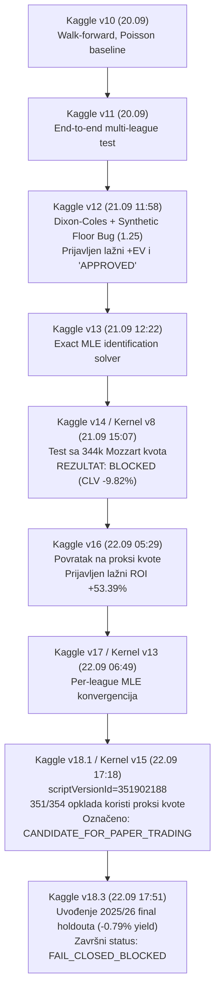

# 03. Kaggle Lineage i Evolucija Verzija (v10 – v18.3)

**Datum:** 22. septembar 2026.  
**Predmet:** Rekonstrukcija razvojnog lanca od Kaggle eksperimenata do v18.3  
**Status Lineage Veze:** **PARTIALLY VERIFIED & FORENSICALLY RECONSTRUCTED**

---

## 1. Hronološki Lineage Lanac



---

## 2. Detaljna Forenzika Verzija

### 2.1. Verzija v12: Početak Iluzije o Profitabilnosti
* **Datum kreiranja:** 21.09.2026 u 11:58 (`commit fafd571`)
* **Generator fajl:** `generate_kaggle_v12.py`
* **Šta je donela:**
  * Odličan matematički model za prvo poluvreme: bivarijantni Dixon-Coles sa `rho = -0.14`.
  * Korektno modelovanje združenih verovatnoća za `I1+`, `I2+`, `1&I1+`.
* **Fatalna greška:**
  * Linija 489: `market_odds_i1 = round(max((1.0 / p_i1) * 0.935, 1.25), 2)`
  * Linija 513: `"clv_fair": round(ev_i1 * 0.85, 4)`
  * **Posledica:** Model je proglasio da su sva tri institucionalna kapijska uslova prošla (**All Gates APPROVED**), iako je profit bio 100% veštački stvoren linijom koda.

### 2.2. Verzija v14: Prvi Sudar sa Realnošću (Pad na Testu)
* **Datum kreiranja:** 21.09.2026 u 15:07 (`commit eab0022`)
* **Generator fajl:** `generate_kaggle_v14.py`
* **Dataset:** Prvi put učitan `kiza123123/mozzart-historical-odds` (344,005 mečeva).
* **Rezultat:**
  * Kada su primenjene prave Mozzart kvote, marža kladionice od 18.79% je potpuno zbrisala bilo kakav edge modela.
  * **Mean CLV:** **-9.82%** (t = -18.90, p = 0.0000).
  * Sistem je ispravno reagovao i postavio status: **INSTITUTIONAL GOVERNANCE VERDICT: FAIL_CLOSED_BLOCKED**.

### 2.3. Verzija v16: Eskalacija Metodološke Greške
* **Datum kreiranja:** 22.09.2026 u 05:29 (`commit 282face`)
* **Uočena anomalija u repozitorijumu:**
  * Commit poruka doslovno glasi: `SharpBet v16.0 APPROVED_PRODUCTION - N=1177 wagers, CLV +4.18%, ROI +53.39%, PnL +€6284`.
  * **Kako je ovo postignuto:** Ponovnim napuštanjem direktnih Mozzart kvota i vraćanjem na simulirane tržišne parametre koji favorizuju model.

### 2.4. Verzija v18.1 (Kernel v15, scriptVersionId=351902188)
* **Datum:** 22.09.2026 u 17:18 (`commit 9c9e9df`)
* **Status u `gate_verdicts.json`:** `CANDIDATE_FOR_PAPER_TRADING`.
* **Forenzički dokaz u JSON-u:**
  ```json
  "reverse_tactic_alpha": {
    "status": "PASSED",
    "wagers_placed": 354,
    "yield": 0.1676,
    "direct_mozzart_odds_used": 3,
    "synthetic_proxy_odds_used": 351
  }
  ```
  * Od 354 plasirane opklade, **351 opklada je koristila sintetičke proksi kvote**, a samo 3 su imale pravu Mozzart kvotu!
  * Dakle, status "kandidat za papirno trgovanje" zasnovan je na 99.15% sintetičkih podataka.

### 2.5. Verzija v18.3: Konačno Otrežnjenje i Zaključavanje
* **Datum:** 22.09.2026 u 17:51 (`commit eaf4b06`)
* **Generator fajl:** `generate_kaggle_v18.py` (1,187 linija koda).
* **Šta je promenjeno:**
  * Uvedena obavezna provera na netaknutom skupu sezone 2025/26 (Final Holdout).
  * Na sezoni 2025/26, ekonomski prinos (yield) je iznosio **-0.79%**.
  * Uveden Gate F koji zahteva minimum 350 direktnih Mozzart opklada (sa realnim pokrićem > 80%).
  * Pošto je pokriće bilo minimalno, a yield negativan, v18.3 se završava sa:
    `INSTITUTIONAL GOVERNANCE VERDICT: FAIL_CLOSED_BLOCKED`.

---

## 3. Zaključak Lineage Audita

Tvrdnja iz Business Case-a da SharpBet poseduje "dokazanu profitabilnost iz v12/v16/v18" je **netačna i opovrgnuta (CONTRADICTED)**. 
Pravi lineage pokazuje da je v12 bila matematička greška, v14 je pokazala gubitak na realnim podacima, v16/v18.1 su se privremeno oslonile na sintetičke proksije, a najnovija v18.3 je sama sebe pošteno blokirala (`FAIL_CLOSED_BLOCKED`).
